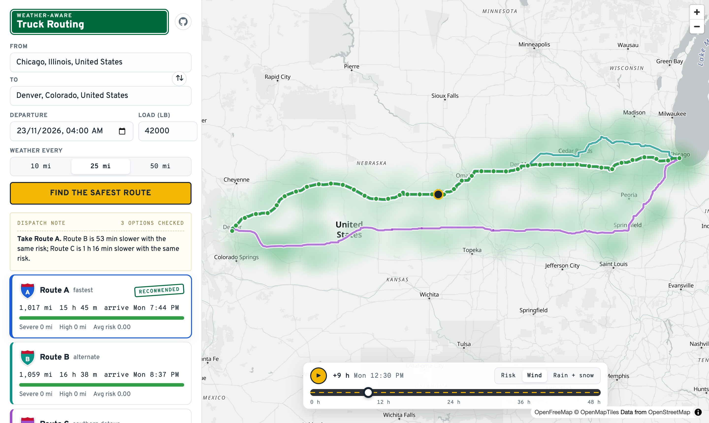

# Weather-Aware Truck Routing

React + Django app that helps a truck driver pick the safest of three routes, based on the weather the truck will actually drive into, the load it's carrying, and travel time.

**Live:** https://weather-truck-routing-theta.vercel.app



## What it does

1. Enter origin, destination, departure time, load weight, and how often to sample weather (every 10, 25 or 50 miles).
2. The backend asks for three truck routes, cuts each one into checkpoints, works out when the truck reaches each checkpoint, and pulls the forecast **for that hour** at that spot.
3. Each checkpoint gets a risk level from the wind / rain / snow table and the load rules. Each route gets miles per risk level and an average risk.
4. Routes are ranked by fewest Severe miles, then fewest High miles, then lowest average risk, then shortest travel time. The UI says why the winner won.
5. The map shows all three routes, the selected one coloured by risk between checkpoints, a popup per checkpoint (ETA, wind, gusts, rain, snow, temperature, why it's risky), and a weather heatmap over the trip corridor with a 0–48 h slider. A truck marker shows where the selected route puts you at the slider's hour.

## Risk rules

| Condition | Low | Moderate | High | Severe | No Travel |
|---|---|---|---|---|---|
| Wind (mph) | < 25 | 25–34 | 35–44 | 45–54 | ≥ 55 |
| Rain (in/hr) | < 0.10 | 0.10–0.25 | 0.25–0.50 | 0.50–1.00 | > 1.00 |
| Snow (in/hr) | < 0.5 | 0.5–1.0 | 1.0–2.0 | 2.0–3.0 | > 3.0 |

Load rules on top of the wind band: ≥ 55 mph is No Travel for any load; 45–54 mph with more than 30,000 lb is No Travel; 35–44 mph with more than 40,000 lb is Severe.

Decisions I had to make where the brief leaves room:

- **Shared edges** (e.g. rain 0.25 is in both Moderate and High): the value goes to the higher band.
- **Wind** is sustained 10 m wind speed. Gusts are shown in the popup but don't drive the level.
- **Rain / snow** are Open-Meteo's hourly amounts (inches that fell in the hour), which is the in/hr rate the table means.
- **The checkpoint's level** is the worst of the three conditions.
- **Miles per level**: each checkpoint stands for half the distance back to the previous one and half to the next, so the miles add up to the route length.
- **Average risk** is distance-weighted, with Low = 0 … No Travel = 4.
- **No Travel** miles rank before Severe miles, so a route the rules forbid never wins over one they allow.
- **Weather at a checkpoint** is interpolated between the two forecast hours around the truck's ETA.

## Routing, weather and geocoding

| | Service | Notes |
|---|---|---|
| Routes | [Valhalla](https://valhalla.github.io/valhalla/) public server, `truck` costing | Gross weight = 35,000 lb empty truck + the entered load, so weight limits apply. ETAs come from Valhalla's per-maneuver times, spread along each maneuver's shape. |
| Weather | [Open-Meteo](https://open-meteo.com/) hourly forecast | wind, gusts, rain, snowfall, temperature in mph / inches / °F. Many points per request. |
| Places | [Photon](https://photon.komoot.io/) | search-as-you-type for origin and destination |
| Map | MapLibre GL + [OpenFreeMap](https://openfreemap.org/) tiles | no API keys anywhere |

Three route options: Valhalla returns at most two on long trips, so the third comes from routing through a point pushed off one side of the corridor and keeping it only if less than 85% of it overlaps an existing option and it takes under 1.6× the fastest time. The public server rejects requests longer than 1,500 km straight-line, so long trips are routed in hops of at most 600 miles and stitched together (out-and-back spurs at the joins are trimmed).

Open-Meteo's free tier counts every location as one call (600 per minute), so checkpoint weather is looked up on a 0.1° grid (~7 miles, about the forecast models' resolution), and each plan is capped at about 330 lookups plus the heatmap; very long trips at 10-mile spacing fall back to a coarser grid.

## Performance

- One `POST /api/plan` returns everything (routes, checkpoints, summaries, heatmap for every hour), ~5–10 s for a cross-country trip, mostly waiting on the routing server. Results are cached for 10 minutes.
- Route lines are simplified (Douglas-Peucker, ~40 m) before they're sent: ~190 KB for a 1,000-mile trip with three routes and a 49-hour heatmap.
- The heatmap uploads its data once per plan, with every hour stored as a property on each point. The slider only swaps the `heatmap-weight` expression, so nothing is re-uploaded: ~5 ms per step on a laptop GPU.

## Run locally

```bash
python3.12 -m venv .venv && .venv/bin/pip install -r requirements.txt
cd backend && DJANGO_DEBUG=1 ../.venv/bin/python manage.py runserver   # API on :8000

cd frontend && npm install && npm run dev                              # UI on :5173, proxies /api
```

Tests (risk table edges, load rules, ranking, checkpoint maths, geometry):

```bash
cd backend && DJANGO_DEBUG=1 ../.venv/bin/python manage.py test routing
```

## Deploy

One Vercel project: the Vite build is served as static files and Django runs as a Python function (`api/index.py`) behind `/api/*` (see `vercel.json`). Import the repo on Vercel and deploy; no environment variables are needed. Optional: `DJANGO_SECRET_KEY`, `ALLOWED_HOSTS` for a custom domain, and `VALHALLA_URL` / `OPEN_METEO_URL` / `PHOTON_URL` to point at your own instances.

## API

`GET /api/places?q=omaha` → `{ results: [{ label, lat, lon }] }`

`POST /api/plan`

```json
{ "origin": {"lat": 41.88, "lon": -87.63}, "destination": {"lat": 39.74, "lon": -104.99},
  "departure": "2026-11-23T08:00:00Z", "load_lb": 42000, "interval_mi": 25 }
```

returns `routes[]` (geometry, distance, duration, checkpoints with ETA, weather and risk, `summary.miles_by_risk`, `average_risk`, `rank`), `recommended`, `reason`, and `heatmap` (`points`, `hours`, and per-hour `risk`, `wind_mph`, `precip_in_hr`).

## Layout

```
backend/routing/risk.py        risk table + load rules
backend/routing/planner.py     checkpoints, ETAs, summaries, ranking, heatmap grid
backend/routing/providers/     valhalla.py, openmeteo.py, geocode.py
backend/routing/views.py       /api/places, /api/plan
frontend/src/components/       MapView, HeatmapControls, TripForm, RouteList, CheckpointTable
api/index.py, vercel.json      Vercel entry
```

## Limits

- Public routing/weather servers are free and rate-limited; under heavy use a plan can fail with a "try again in a minute" message.
- Travel time is Valhalla's driving time. There are no hours-of-service rest breaks in the ETAs.
- Departure has to be within the forecast range (now to 10 days out).
- Sustained wind, not gusts, sets the wind level.
